# 👓 Heads-Up Desk: a crypto trading desk you wear

**A glanceable crypto HUD for Even Realities G2.** See live Hyperliquid prices and positions, funding, and Polymarket odds, plus the crypto chatter in your Telegram groups. Act on any of it with one tap or a short voice command. Your phone stays in your pocket.

Built for **Heads Up: Even Realities Hackathon** (TVM Ventures × Daos Hub, Nov 23–29, 2026).
**Main track:** 02 · Crypto & DeFi (Hyperliquid · Polymarket · Trust Wallet). **Second track:** 01 · Messaging & News (Telegram). **Special prize:** Best Telegram integration.

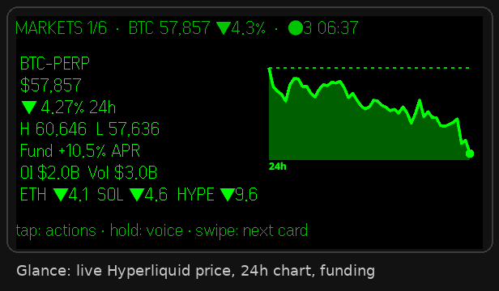

**[2-minute demo — 1080p MP4](docs/demo.mp4)** (1:52, H.264). Recorded from the Even Hub simulator, with captions and narration. Voice segments are labeled **SIMULATED MIC INPUT**.

*The GIF and the video use the real 576×288 G2 framebuffer, captured headless from `evenhub-simulator` 0.9.5 through its automation API (`scripts/sim.py tour` / `scripts/demo-video.py`).*

---

## The problem

Crypto markets run 24/7, and staying on top of them is mostly checking: is BTC still above my level, did funding flip, what are the odds on tomorrow's close, did someone in the group chat just post something I need to see? Every check means unlocking a phone, opening three apps (exchange, Polymarket, Telegram), and getting pulled away from whatever you were doing.

**Heads-Up Desk turns those checks into glances.** One thing on screen at a time, a few words, and a single tap or a short phrase to act. It is built for active traders, DeFi users and crypto community members who already live in Hyperliquid, Polymarket and Telegram.

## What it does

| Glance (read) | Act (write) |
|---|---|
| **Markets:** live Hyperliquid mid, 24h change, high/low, funding APR, OI and volume, plus a **24h sparkline** rendered to the G2 image container | Set a ±2% alert, paper long/short, jump to the next coin, share to Telegram |
| **Positions:** any Hyperliquid account (read-only) with side, leverage, uPnL, liq price; **Trust Wallet** ETH + USDC balances on Ethereum and Base; your paper book | Close paper positions; send a Trust Wallet deep link to Telegram |
| **Funding:** the biggest funding payers on each side among perps with more than $10M OI | Alert when a coin's funding passes X% APR |
| **Odds:** Polymarket's "BTC above ___ on <date>" board, **laddered around the live Hyperliquid price** (the 3 strikes nearest spot) | Paper bet YES/NO at the live price |
| **Alerts:** armed/hit status and distance to trigger. **The server watches 24/7 and pushes hits to Telegram**, so you get them even when the G2 app is closed | Delete or clear alerts |
| **Telegram:** crypto-relevant messages from your groups (cashtags and coin names only, everything else is filtered out), each with **live market context** for the coin being discussed | **One-tap reply drafted from live data** ("ETH 1,623 (−4.2% 24h), funding −3% APR. Watching."), or dictate your own |

### Interaction model (designed for the temple touchpad and the R1 ring)

| Gesture | What happens |
|---|---|
| **Swipe ▲▼** | Move between the 6 cards |
| **Tap** | Open that card's one-tap action list (native G2 list, firmware highlight) |
| **Tap** on an action | Reads and alerts run right away. **Paper orders, bets and Telegram messages show a confirm screen first** |
| **Hold** | **Push-to-talk.** The G2 mic streams 16 kHz PCM, a live level meter shows on the glasses, release to send. Whisper transcribes it, and a deterministic parser turns it into a proposed action that you confirm with a tap |
| **Double-tap** | Back or cancel. On the root card it opens the system exit dialog (`shutDownPageContainer(1)`, per the QA guidelines) |
| **Tap + hold** | G2 contextual menu: Refresh · Next coin · Alert +2% · Alert −2% · Share to Telegram |

Voice commands, each tested end to end through the real audio path:

```
"alert bitcoin above 60k"        "alert eth below 2.9k"         "alert sol down 5 percent"
"notify me when hype funding is above 30"                         "long ETH 200 dollars"
"short it"   "close ETH"   "bet yes 20"   "show funding"   "doge"   "share this to telegram"
"reply: on it, adding on dips"   (on the Telegram card, anything you say becomes a reply draft)
```

## Screenshots (real simulator framebuffer)

| | |
|---|---|
| 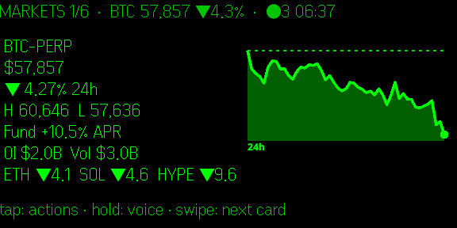 Markets + 24h chart | 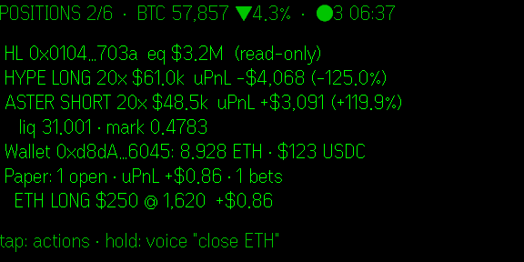 Hyperliquid account + Trust Wallet + paper book |
| 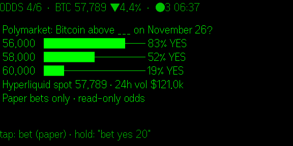 Polymarket odds around live spot | 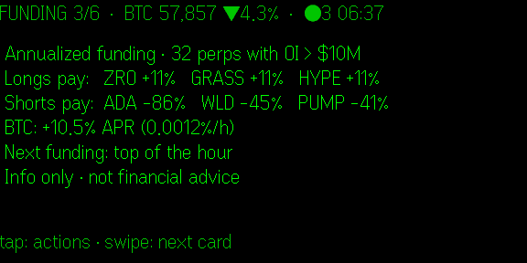 Funding extremes |
| 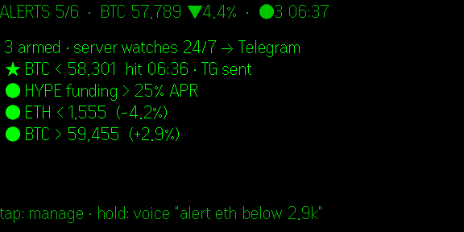 Alerts (★ = hit, pushed to Telegram) | 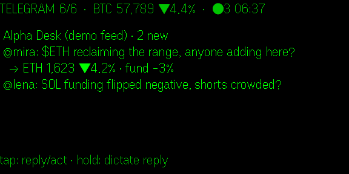 Telegram mentions + live context |
| 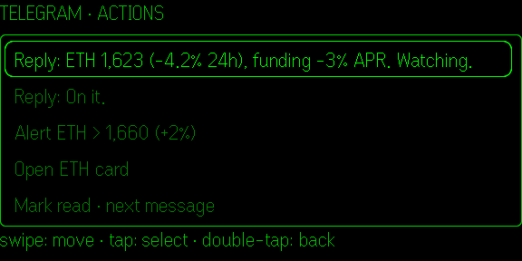 One-tap replies drafted with live data | 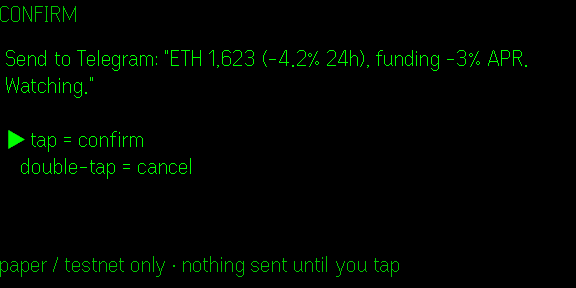 Confirm before anything is sent |
| 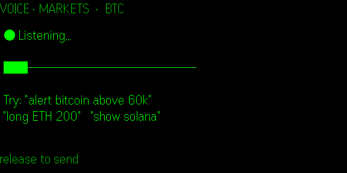 Push-to-talk with live mic meter | 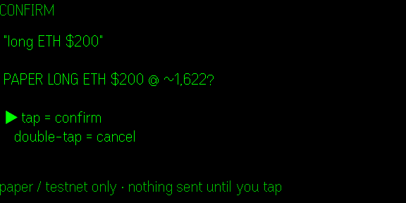 "Long ETH $200" → confirm |
| 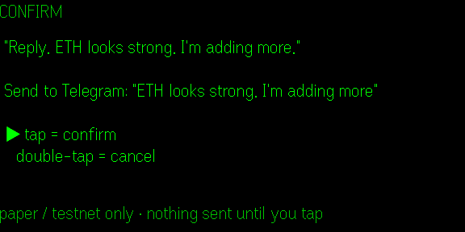 Dictated Telegram reply |  G2 contextual menu |

## Architecture

```
 Even G2 (576×288, mic, touchpad, R1 ring)
        │  BLE via Even Realities App
        ▼
 app/  WebView (Vite + TS + @evenrealities/even_hub_sdk 0.0.16)
   • 3 text containers + 1 image (sparkline), z-ordered; list container for actions
   • textContainerUpgrade for flicker-free 5 s refresh; diffed, so only changed text crosses BLE
   • push-to-talk PCM capture, contextual menu, phone-side settings screen
        │  one whitelisted origin (app.json), CORS handled server-side, no keys in the app
        ▼
 server/  Node 22 + TypeScript (tsx), no framework
   • hyperliquid.ts  public info API: metaAndAssetCtxs, candles, clearinghouseState   (read-only)
   • polymarket.ts   Gamma API: daily "above ___" boards, strike ladder around spot   (read-only)
   • wallet.ts       eth_getBalance / USDC balanceOf on Ethereum + Base                (read-only)
   • hud.ts          renders every card to ≤7 lines × ~60 chars + its action list
   • intent.ts       deterministic voice/typed command parser → proposed Action
   • actions.ts      confirm prompts + execution (paper / Hyperliquid TESTNET / Telegram)
   • alerts.ts       24/7 watcher → Telegram push (G2 apps can't alert in the background)
   • telegram.ts     Bot API long-polling: group mentions in, approved replies out, /link pairing,
                     /price /odds /alerts commands
   • stt.ts          any OpenAI-compatible Whisper endpoint (OpenAI, Groq, or local faster-whisper)
```

The server renders the card text, so the glasses client stays tiny, and a card shared to Telegram is exactly what you saw on the glasses.

## Run it in the simulator (about 3 minutes, no glasses, no keys)

Prereqs: Node 20+ and the Even tools (`npm i -g @evenrealities/evenhub-cli @evenrealities/evenhub-simulator`).

```bash
git clone https://github.com/666Crypro/even-g2-crypto-hud && cd even-g2-crypto-hud
npm run setup                 # installs server/ and app/

# terminal 1: backend in demo mode (Telegram demo feed + public demo addresses, paper trading)
npm run demo                  # http://localhost:8787

# terminal 2: the G2 web app
npm run app                   # http://localhost:5173 (proxies /api to :8787)

# terminal 3: simulator
npm run sim                   # or: npm run sim:demo-mic   (see "Voice" below)
```

In the simulator window: **Up/Down** switches cards, **Click** opens actions or confirms, **Double click** goes back, **hold** (long press) talks. The phone-side page (the WebView) has a **command box** that runs the same pipeline as voice, plus settings for your watchlist, Hyperliquid address and wallet address.

`npm run demo` uses two public addresses as stand-ins: the Hyperliquid **HLP strategy vault** (`0x0104…703a`, public protocol vault) for positions and `vitalik.eth` for wallet balances. Put your own addresses on the phone screen or in `server/.env`.

### Voice

- **Real voice:** set `STT_API_KEY` (OpenAI Whisper) or `STT_BASE_URL` (Groq, or any OpenAI-compatible endpoint) on the server. On a laptop the simulator records from your microphone (`evenhub-simulator --list-audio-input-devices`, `--aid`).
- **Free and local, no key:** `python3 -m venv .stt && .stt/bin/pip install faster-whisper && .stt/bin/python scripts/local-stt.py`, then start the server with `STT_BASE_URL=http://127.0.0.1:9000/v1`. small.en transcribes a command in about 1 s on CPU.
- **Headless / no mic:** open the app with `?demoMic` (`npm run sim:demo-mic`). Each long press replays a bundled 16 kHz PCM clip of synthesized speech in real-time 100 ms frames, just like the G2 mic. It goes through the exact same capture → `/api/voice` → Whisper → parser → confirm path. That is how the voice frames in this README were captured.

### Telegram (real bot)

1. Create a bot with **@BotFather** and set `TELEGRAM_BOT_TOKEN` on the server.
2. DM the bot `/link <code>`. The code is shown on the TELEGRAM card and on the phone screen. Alerts and shared cards now arrive in that DM, with **"Open in Trust Wallet"** and **Hyperliquid** buttons.
3. Add the bot to a crypto group and turn its privacy mode off (`/setprivacy` in BotFather). Messages that mention `$TICKERS` or coin names show up on the glasses with live context, and replies you approve are posted back into the group.

### Headless verification (CI-style)

```bash
npm test                                   # 8 unit suites: intents, odds ladder, alerts, Telegram, WAV, HUD budget
scripts/restart-sim.sh 'http://localhost:5173/?demoMic'   # Xvfb + --automation-port 9898
python3 scripts/sim.py tour                # drives up/down/click/long_press/context_menu, asserts lit pixels,
                                           # writes docs/screenshots/*.png and docs/demo.gif
npx --prefix server tsx server/scripts/testnet-probe.ts  # signs a real Hyperliquid TESTNET order with a throwaway key
```

### Package for G2

Set `VITE_API_BASE` to your deployed backend and put the same origin in `app/app.json` → `permissions[network].whitelist`, then run `npm run pack`. That produces `app/heads-up-desk.ehpk` (validated by `evenhub pack`, min app 2.2.10 / SDK 0.0.16). The backend is a single long-running Node process (Telegram long polling + alert watcher), so Railway, Fly, Render or any small VPS works. It can also serve the built app itself.

## Safety by design (judging criterion 5)

- **Read-only data.** Hyperliquid, Polymarket and wallet calls are public reads. No exchange keys, no custody, no user funds.
- **Paper by default.** Orders fill at the Hyperliquid mid in a local paper book, and bets are paper bets at the live Polymarket price. An optional `HL_TESTNET_PRIVATE_KEY` routes orders to **Hyperliquid testnet** (IOC with a 1% slippage cap). **There is no mainnet code path.**
- **Nothing moves without a confirm tap.** Orders, bets and every Telegram message go through a confirm screen. Voice only *proposes*.
- **No keys in the app.** The WebView talks to one whitelisted backend origin, and secrets live in server env vars (`server/.env.example`) and are git-ignored.
- **Privacy.** Only messages that mention a coin reach the glasses, and only from groups that added your bot. Nothing is stored beyond the last 50 mentions in a local JSON file.
- No financial advice. The funding card is informational.

## Track fit and judging criteria

| Criterion | How Heads-Up Desk answers it |
|---|---|
| **Usefulness on G2 (30%)** | The everyday moment is "checking the market". Each card is one glance: price + chart, my positions, funding, odds, alerts, chat. Alerts reach you through Telegram even when the app is closed, which works around the platform's no-background limit. |
| **Read and write (25%)** | Every card has a one-tap action list with smart defaults (±2% alert levels computed from live price, replies pre-drafted from live data). Push-to-talk turns a short phrase into a confirmable action. Confirm is one tap, cancel is a double-tap. |
| **Technical execution (20%)** | End to end with real public APIs. Typed TS client and server, diffed in-place text updates, serialized image pushes, z-ordered layout, list container, contextual menu, long-press PTT. Unit tests plus an automated simulator tour that asserts on the framebuffer. Packs to `.ehpk`. |
| **UX for display and voice (15%)** | A fixed three-band layout (dim header with ticker and armed-alert count, bright body, dim hint/toast footer), ≤7 lines per card, glyphs from the firmware font only (▲▼●★█─). A live mic meter while you talk, and an echo of what was heard before acting. |
| **Business potential and safety (10%)** | Crypto traders are a large, high-intent audience who already pay for alerting tools. Natural next steps: a premium alert tier, builder/referral fees on testnet → mainnet handoff *on the phone* (Trust Wallet deep links), team/group desks. Safety model above. |

**Second track (Messaging & News):** one flow joins both tracks. A Telegram message about `$ETH` → live Hyperliquid context on the glasses → a one-tap reply drafted from that data, or an alert set on that coin.

## What existed before Nov 23, 2026

All code in this repo was written during the hackathon build week. Pre-existing pieces we build on: the Even Hub SDK, CLI and simulator, the official `evenhub-templates` (minimal/asr/image were used as references), `@nktkas/hyperliquid` + `viem` (testnet signing only), `faster-whisper` (optional local STT), and the public Hyperliquid, Polymarket Gamma, Telegram Bot and Ethereum JSON-RPC APIs.

## Feature requests for the platform and APIs (optional section)

1. **Even Hub:** a sanctioned "glance notification" for apps in the background (e.g. a one-line alert the user can tap to open the app). Today we route alerts through Telegram.
2. **Even Hub:** built-in speech-to-text in the SDK (or a hosted endpoint), so every app doesn't have to run its own Whisper backend.
3. **Even Hub:** in-place list updates and per-container right alignment / tab stops, for price tables that don't reflow.
4. **Polymarket:** a public testnet/sandbox CLOB, so hackathon apps can place real (test) orders instead of paper bets.
5. **Hyperliquid:** a testnet faucet that doesn't require a mainnet deposit. **Telegram:** a scoped, read-only user API for selected personal chats (bots can only see groups they're added to).

## Repo layout

```
app/       G2 WebView app (Vite + TS + Even Hub SDK). app.json, public/icon.png, public/demo-mic/*.pcm
server/    backend (TypeScript). src/*.ts, test/*.test.ts, scripts/testnet-probe.ts, .env.example
scripts/   restart-sim.sh, sim.py (headless tour + screenshots + GIF), local-stt.py (free Whisper)
docs/      demo.gif, screenshots/
SUBMISSION.md  DoraHacks BUIDL text + 2-minute demo script
```

MIT © 2026 Arthur Shavlovsky
